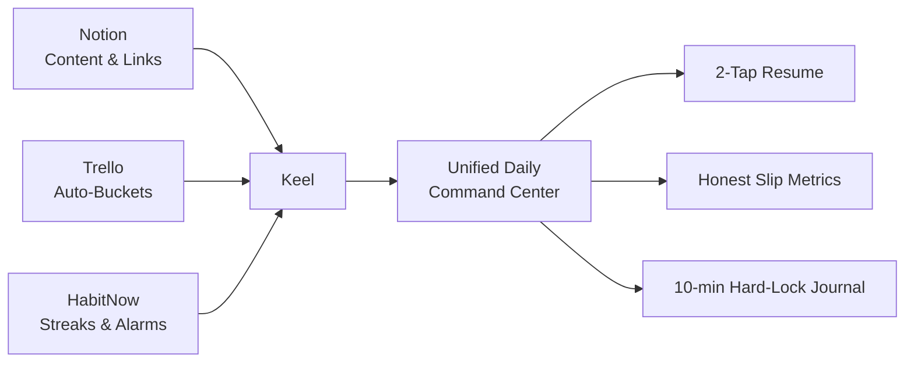
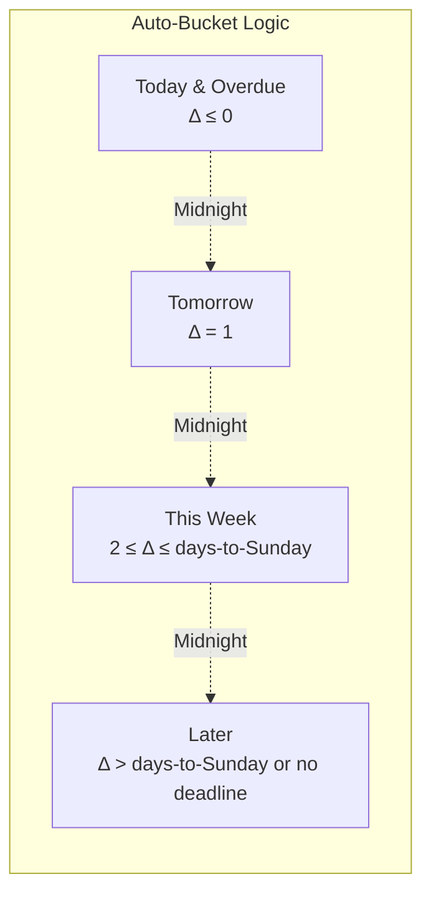
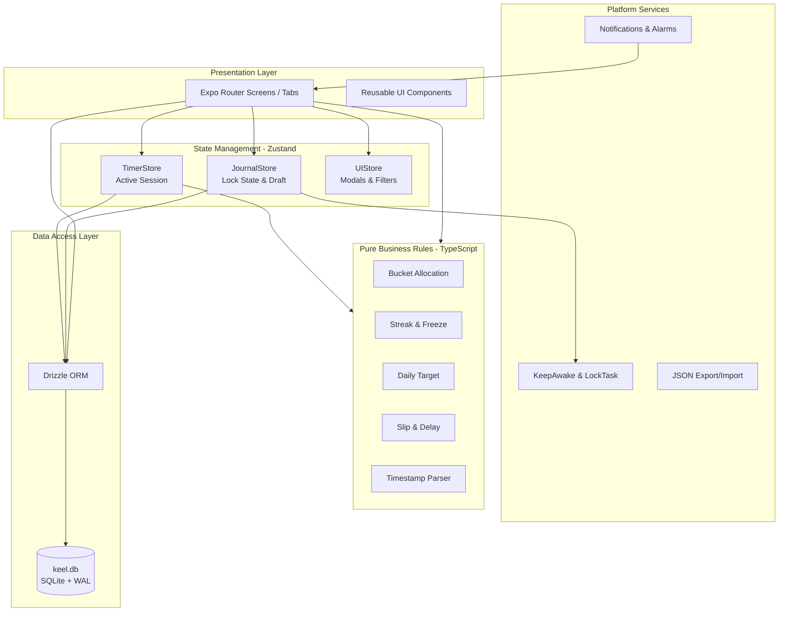
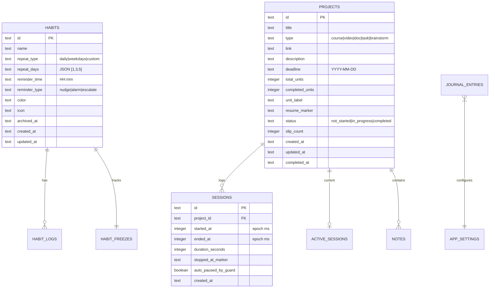

# Keel

<p align="center">
  
</p>

<h1 align="center">Pick up exactly where you stopped, and see honestly where you slipped.</h1>

<p align="center">
  <strong>A minimal, offline-first Android productivity app that unifies work tracking, habit streaks, and locked journaling — built for self-directed learners and developers.</strong>
</p>

<p align="center">
  <a href="#-quick-start"></a>
  <a href="#-architecture"></a>
  <a href="#-cost"></a>
  <a href="#-license"></a>
</p>

<p align="center">
  
  
  
  
  
  
</p>

---

## 📥 Download & Run Immediately (GitHub Release Package)

You can download the pre-built, production Android APK directly from GitHub Releases:

[](../../releases/latest)

1. **Download**: Go to [**GitHub Releases**](../../releases/latest) and download `app-release.apk`.
2. **Install**: Tap `app-release.apk` on your Android device (enable *"Install unknown apps"* if prompted).
3. **Run**: Keel starts instantly with local SQLite database initialized — no login, no cloud, no setup.
4. **Seamless Auto-Updates**: When new updates are pushed, Keel automatically checks for updates via `expo-updates` on app start and applies them seamlessly without reinstalling!

---

Self-directed learners juggle **three disconnected tools** daily:

| Tool | Strength | Critical Gap |
|------|----------|--------------|
| **Notion** | Flexible notes, databases, links | No native **stopping-point tracking** (video timestamp, page, lesson). Heavy setup. |
| **Trello** | Visual Kanban buckets | **Zero delay accountability** — drag cards endlessly, no slip metrics, no days-late data. |
| **HabitNow** | Streaks, reminders, timers | **No content context** — habits exist in isolation from courses, videos, projects. |

**Result:** Context fragmentation, lost stopping points, invisible procrastination, app-hopping fatigue.

---

## ✨ The Keel Difference



### Four Core Principles

| Principle | What It Means |
|-----------|---------------|
| **Bare-Minimum & Smart** | Every screen does one job. No nested pages, no markdown gymnastics, no relational DB for users to configure. |
| **Honest Metrics** | Procrastination = slips (tracked). Timers >3hrs = guard (triggered). No vanity streaks, no hidden delays. |
| **Work ≠ Habits** | Habits = day-wise routines with streaks/heatmaps. Work = finite projects with deadlines, timers, notes, stopping markers. Separate tracking, separate insights. |
| **Local-First Sovereignty** | 100% on-device SQLite. Zero cloud, zero auth, zero subscriptions. Full JSON export/import. |

---

## 🏆 Unique Mechanics (Not Found Elsewhere)

### 1. **2-Tap Resume — The North Star**
> Cold launch → Today screen → **Tap "Resume"** → Link opens + timer starts.

| Traditional Flow | Keel Flow |
|------------------|-----------|
| Open Notion → Find page → Copy link → Open YouTube → Seek to timestamp → Start timer app | **Open Keel → Tap Resume** |

The **Continue Card** on Today shows your last active project with its exact resume marker (`Stopped at: 14:32` / `Lesson 12` / `Page 84`). One tap resumes everything.

---

### 2. **Auto-Buckets — No Manual Dragging**
Projects sort themselves by deadline. **You never drag cards.**



**Overdue items pin to top of Today** with `Overdue (N days)` badge. They never vanish.

---

### 3. **Slip Tracking — Accountability Built In**
Every postponement is recorded. No silent delays.

| Action | Slip Count | Days Late |
|--------|------------|-----------|
| Move deadline later | `+1` | — |
| Smart Snooze → "Move to Tomorrow" | `+1` | — |
| Midnight passes while in Today (untouched) | `+1` | — |
| Complete project after deadline | — | `completion_date - deadline` |

**Insights show:** Total slips, on-time %, average days late, slip histogram.

---

### 4. **Daily Target Auto-Calc — Pacing for Students**
> *Course: 30 lessons, deadline in 5 days → "5 lessons/day"*

```typescript
// Pure function — zero side effects, 100% tested
function calculateDailyTarget(total, completed, deadline, today) {
  const remaining = Math.max(0, total - completed);
  const daysLeft = differenceInCalendarDays(deadline, today);
  if (daysLeft <= 0) return remaining;        // Due today = all remaining
  if (remaining === 0) return 0;              // Done
  return Math.ceil(remaining / (daysLeft + 1)); // +1 includes today
}
```

Works for lessons, pages, video minutes — any unit.

---

### 5. **Timestamp Deep-Links — Notes That Navigate**
Add a note: `14:20 – explains useEffect cleanup`

Tap `14:20` → **Opens YouTube app at exactly 14:20** (`vnd.youtube://<id>?t=860`)

| Format | Parsed To | Example |
|--------|-----------|---------|
| `MM:SS` | seconds | `12:40` → 760s |
| `HH:MM:SS` | seconds | `01:05:20` → 3920s |

---

### 6. **Forgot-Timer Guard — Honest Time Tracking**
Timer runs 3 hours → `"Still working on [Project]?"` alert → 15-min grace → **Auto-pause at exactly 3:00:00**

| Scenario | Result |
|----------|--------|
| User taps "Keep Going" | Threshold extends +1 hour |
| User taps "Pause Now" | Session saved, "Stopped at?" modal opens |
| No response (15 min) | Timer clamps to 3hr, `auto_paused_by_guard: true` logged |

Prevents accidental 20-hour sessions from corrupting analytics.

---

### 7. **Journal Hard Lock — Discipline Enforced**
**Daily: 10 minutes (600s). Weekly (Sunday): 20 minutes.**

| Layer | Mechanism |
|-------|-----------|
| **1. Back Button** | `BackHandler` intercepts → toast: *"Session locked. Complete 10 minutes to exit."* |
| **2. Screen Wake** | `expo-keep-awake` — display never dims/locks |
| **3. Screen Pinning** | Native `startLockTask()` — blocks Home, Recents, Status Bar (Android kiosk mode) |
| **4. Reset Penalty** | App backgrounds → **Timer resets to 10:00** — draft autosaved, but session must be restarted |

> **Draft is never lost.** Only the clock resets. You *must* complete one uninterrupted block.

---

### 8. **Streak Freezes — Real Life Happens**
- **2 freezes/month** (resets 1st of month, no rollover)
- Apply to **Yesterday or Today** only (48-hour window)
- Max **2 consecutive days** per habit
- Freeze = streak preserved, `status: 'frozen'` in log

---

## 📱 The 5 Tabs

| Tab | Purpose | Key Components |
|-----|---------|----------------|
| **Today** | Daily cockpit | Continue Card, Habits Pending, Work Pending, Quick Capture |
| **Habits** | Routine tracking | Checklist, streak pills, freeze manager, weekly % bar |
| **Work** | Project hub | Buckets view / Calendar view toggle, Project Detail, Timer, Notes |
| **Journal** | Locked reflection | 10-min daily lock, 20-min Sunday review, autosave draft |
| **Insights** | Honest analytics | Habits: heatmap, streaks, completion % / Work: hours, slips, on-time %, Gantt bars |

---

## 📊 MVP Scope

### ✅ In Scope (8 Milestones)

| # | Milestone | Deliverables |
|---|-----------|--------------|
| 1 | Foundation & DB | Expo + NativeWind + SQLite + Drizzle + 5 tabs |
| 2 | Work & Timer | Projects, buckets, epoch-timer, "Stopped at?", notes, YouTube deep-link, forgot-guard |
| 3 | Habits & Streaks | CRUD, streak engine, monthly freezes, reminders |
| 4 | Today Cockpit | Continue Card, pending sections, Quick Capture |
| 5 | Journal Hard Lock | 10-min lock, tri-layer defense, reset penalty, Sunday mode |
| 6 | Insights & Charts | SVG heatmap, SVG Gantt bars, stats queries |
| 7 | Reminders & Alarms | 3 tiers (Nudge/Alarm/Escalate), exact alarms, boot recovery, smart snooze |
| 8 | Backup & Release | JSON export/import (Zod), local APK build, final QA |

### ❌ Explicitly Out of Scope

| Category | Excluded |
|----------|----------|
| **Cloud/Server** | Firebase, Supabase, AWS, Mongo, any remote DB |
| **Auth** | Login, passwords, OAuth, sessions, multi-user |
| **AI** | LLM integrations, summarization, chat |
| **Collaboration** | Sharing, teams, public links, comments |
| **Rich Editing** | Markdown blocks, nested pages, relational DBs |
| **UI Extras** | Themes, widgets, drag-and-drop Kanban, Pomodoro cycles |
| **Platform** | iOS, Web, Desktop |

---

## 🏗 Architecture



### Key Architectural Decisions

| Decision | Rationale |
|----------|-----------|
| **Pure functions for all business logic** | Testable, portable, zero side effects — `/src/rules/` = 100% coverage |
| **Timestamp-based timers** | Survives app kill, OS reclaim, device reboot — `started_at` + `accumulated_ms` in SQLite |
| **No `setInterval` counters** | Eliminated drift, battery drain, background death |
| **SQLite WAL + FKs** | Concurrent reads/writes, referential integrity, crash resilience |
| **Zustand for ephemeral state** | Timer UI, journal lock, modals — no prop drilling |
| **NativeWind (Tailwind)** | Design tokens as CSS variables, dark OLED theme, rapid iteration |

---

## 🗄 Data Model



---

## 🧮 Business Rules (Pure Functions)

All in `/src/rules/` — **zero dependencies, zero side effects, 100% Jest coverage**.

| Function | Input | Output | Test File |
|----------|-------|--------|-----------|
| `calculateBucket(deadline, refDate)` | Date \| null, Date | `'today' \| 'tomorrow' \| 'this_week' \| 'later'` | `buckets.test.ts` |
| `calculateDailyTarget(total, completed, deadline, refDate)` | number, number, Date, Date | number \| null | `targets.test.ts` |
| `computeHabitStreak(scheduledDays, logs, currentDate)` | number[], Map<date, status>, Date | `{current, best}` | `streaks.test.ts` |
| `computeSlipMetrics(project, completionDate)` | Project, Date | `{slipCount, daysLate}` | `slips.test.ts` |
| `parseYouTubeTimestamp(url, timestampStr)` | string, string | `{seconds, deepLinkUrl}` | `youtube.test.ts` |

**Example: Bucket Allocation**
```typescript
export function calculateBucket(deadline: Date | null, referenceDate = new Date()): Bucket {
  if (!deadline) return 'later';
  const today = startOfDay(referenceDate);
  const target = startOfDay(deadline);
  const delta = differenceInCalendarDays(target, today);

  if (delta <= 0) return 'today';           // Overdue or due today
  if (delta === 1) return 'tomorrow';
  const daysToSunday = differenceInCalendarDays(endOfWeek(today, { weekStartsOn: 1 }), today);
  if (delta <= daysToSunday) return 'this_week';
  return 'later';
}
```

---

## 🤖 Android Platform Advantages (Why Not PWA)

| Capability | PWA | Keel (React Native + Expo) |
|------------|-----|----------------------------|
| **Exact Alarms** (ring until dismissed) | ❌ Impossible | ✅ `SCHEDULE_EXACT_ALARM` + custom audio channel |
| **Escalating Reminders** (nudge → vibration → alarm) | ❌ Flaky | ✅ Native notification channels + boot receiver |
| **Journal Lock** (block Home/Recents) | ❌ Cannot | ✅ `startLockTask()` screen pinning + tri-layer fallback |
| **Background Timer Survival** | ❌ Tab dies | ✅ SQLite timestamps + foreground service ready |
| **YouTube Deep-Link** (open at timestamp) | ⚠️ Browser only | ✅ `vnd.youtube://` intent → native app |
| **File System Access** (backup/restore) | ⚠️ Limited | ✅ `expo-file-system` + SAF picker |

> **Screen pinning** requires a ~50-line Kotlin module (`KeelLockModule.kt`) — included in `docs/08-android-platform-spec.md`.

---

## 🛣 Roadmap

```mermaid
gantt
    title Keel Development Roadmap
    dateFormat  YYYY-MM-DD
    axisFormat  %b %d
    section Foundation
    M1: Foundation & DB          :done, m1, 2026-10-20, 7d
    section Core Features
    M2: Work & Timer             :active, m2, after m1, 14d
    M3: Habits & Streaks         :m3, after m2, 10d
    M4: Today Cockpit            :m4, after m3, 5d
    M5: Journal Hard Lock        :m5, after m4, 10d
    section Analytics & Polish
    M6: Insights & Charts        :m6, after m5, 10d
    M7: Reminders & Alarms       :m7, after m6, 10d
    M8: Backup & Release APK     :m8, after m7, 5d
```

**Total: ~8–11 weeks** for solo developer.

---

## 🧪 Testing Strategy

| Tier | Scope | Target | Tools |
|------|-------|--------|-------|
| **1. Unit** | Pure rule functions (buckets, streaks, targets, slips, YouTube) | **100% coverage** | Jest |
| **2. Integration** | DB migrations, FK cascades, transactions, backup round-trip | Critical paths | Jest + SQLite |
| **3. Acceptance** | 2-Tap Resume, Journal lock, Alarm rings, Boot recovery | Device verification | Physical Android |

### North Star Acceptance Test
```gherkin
Given a YouTube course project with resume marker "14:32"
And the app is completely closed (cold start)
When I open Keel
And I tap "Resume" on the Continue Card
Then the YouTube app opens at 14:32
And a session timer starts automatically
And total taps from launch = 2
```

---

## 🔧 Build & Install (Zero Cost)

### Prerequisites
- Node.js 20+ (LTS)
- Android Studio (for SDK, emulator, Gradle)
- Physical Android device (recommended for alarms/pinning)

### Local Development
```bash
# 1. Clone & install
git clone <repo> keel && cd keel
npm install

# 2. Start dev client (requires USB debugging)
npx expo run:android

# 3. Or use emulator
npx expo start --android
```

### Production APK (Sideloadable, No Play Store)
```bash
# 1. Prebuild (generates /android native project)
npx expo prebuild --platform android

# 2. Build release APK locally
cd android && ./gradlew assembleRelease

# 3. Output: android/app/build/outputs/apk/release/app-release.apk
#    Transfer to phone → Install (allow "Unknown Sources")
```

### CI (Optional — GitHub Actions Free)
```yaml
# .github/workflows/build.yml
on: [push]
jobs:
  build:
    runs-on: ubuntu-latest
    steps:
      - uses: actions/checkout@v4
      - uses: actions/setup-node@v4
      - run: npm ci
      - run: npx expo prebuild --platform android
      - run: cd android && ./gradlew assembleRelease
      - uses: actions/upload-artifact@v4
        with:
          name: keel-apk
          path: android/app/build/outputs/apk/release/*.apk
```

---

## 📦 Backup & Restore (User Sovereignty)

```typescript
// Export: Complete DB → JSON (validated by Zod)
const backup = await exportDatabase(); // { version: 1, exportedAt, data: {...} }
await shareFile(backup, 'keel-backup-2026-10-20.json');

// Import: JSON → Zod parse → Transaction → Replace DB
const parsed = KeelBackupSchema.parse(json);
await importDatabase(parsed); // Atomic, validates every record
```

**Schema versioning** — `version: 1` in backup, migrations handle upgrades.

---

## 📚 Documentation Index

All specifications in `/docs` — implementation-grade detail:

| # | Document | Purpose |
|---|----------|---------|
| 01 | `01-problem-analysis.md` | Problem, vision, competitive audit |
| 02 | `02-prd.md` | Full product requirements (5 tabs, all features) |
| 03 | `03-rules-edge-cases.md` | Pure business logic specs + algorithms |
| 04 | `04-ux-screen-spec.md` | Design tokens, screen specs, component specs |
| 05 | `05-trd.md` | Tech stack, architecture, performance budgets |
| 06 | `06-data-schema.md` | Drizzle schema, SQL queries, Zod backup schema |
| 07 | `07-app-architecture.md` | Folder structure, Zustand stores, data flow |
| 08 | `08-android-platform-spec.md` | Permissions, exact alarms, screen pinning Kotlin |
| 09 | `09-test-acceptance-plan.md` | Test specs + acceptance criteria |
| 10 | `10-milestones.md` | 8-phase execution plan |

**Agent Rules:** `AGENTS.md` (repo root) — non-negotiable engineering laws.

---

## 🧠 Key Decisions Log

| Decision | Options Considered | Chosen | Rationale |
|----------|-------------------|--------|-----------|
| **Platform** | PWA, Capacitor, React Native | **React Native + Expo** | Exact alarms, screen pinning, background survival — PWA cannot deliver core USP |
| **Database** | IndexedDB, WatermelonDB, Realm | **expo-sqlite + Drizzle** | Relational, typed, WAL, zero config, migrations, works offline |
| **State** | Redux, Context, Jotai | **Zustand** | <1KB, no providers, TypeScript-first, perfect for timer/journal/UI |
| **Styling** | StyleSheet, Styled Components | **NativeWind v4** | Tailwind tokens, dark mode native, CSS variables, rapid iteration |
| **Charts** | Victory, Recharts, FLChart | **react-native-svg (custom)** | Zero deps, full control, heatmap + Gantt = ~200 lines SVG |
| **Alarms** | notifee, expo-notifications only | **expo-notifications + custom Kotlin channel** | notifee maintenance gaps; native channel = true alarm audio |
| **Build** | EAS Build, Expo Application Services | **Local Gradle** | Free, no queue, full control, sideloadable APK |

---

## 💰 Cost Breakdown (₹0 Forever)

| Item | Cost | Notes |
|------|------|-------|
| Expo Framework | Free | MIT |
| React Native | Free | MIT |
| SQLite (expo-sqlite) | Free | MIT |
| Drizzle ORM | Free | MIT |
| NativeWind | Free | MIT |
| Android Studio | Free | Official IDE |
| Gradle Build | Free | Local machine |
| GitHub (Private Repo) | Free | Unlimited |
| GitHub Actions | Free | Public repos / self-hosted |
| Figma (Wireframes) | Free | 3 files, enough |
| Icons / Sounds | Free | MaterialCommunityIcons, freesound.org |
| **Total** | **₹0** | **No subscriptions, no API keys, no server** |

---

## 🤝 Contributing

This is a **solo, personal project** built for my own workflow. The codebase follows strict conventions (`AGENTS.md`) and is not accepting external contributions at this time.

However — the **architecture, pure rules, and Android specs** are openly documented. Feel free to:
- Fork for your own use
- Adapt the pure rule functions (bucket, streak, target, slip, YouTube)
- Reference the Kotlin modules for screen pinning / alarm channels
- Learn from the offline-first + timestamp-timer patterns

---

## 📄 License

**MIT License** — see `LICENSE` file.

```
Copyright (c) 2026 Keel

Permission is hereby granted, free of charge, to any person obtaining a copy
of this software and associated documentation files (the "Software"), to deal
in the Software without restriction, including without limitation the rights
to use, copy, modify, merge, publish, distribute, sublicense, and/or sell
copies of the Software...
```

---

## 🙏 Acknowledgements

- **Expo Team** — For making React Native accessible without native toolchain pain
- **Drizzle Team** — For the best TypeScript ORM experience
- **NativeWind** — Tailwind on React Native, done right
- **date-fns** — Date math that doesn't bloat bundles
- **react-native-svg** — Charts without the weight
- **Android Platform** — For `SCHEDULE_EXACT_ALARM`, `startLockTask`, and boot receivers

---

## 📸 Screenshots (Placeholders)

> Replace with actual screenshots post-build

| Today — Continue Card | Work — Buckets View | Journal — Hard Lock |
|:---------------------:|:-------------------:|:-------------------:|
|  |  |  |

| Habits — Streaks & Freeze | Insights — Heatmap | Insights — Gantt Calendar |
|:-------------------------:|:------------------:|:-------------------------:|
|  |  |  |

---

## 🔗 Quick Links

- **[Build Prompt for AI Agents](AGENT_BUILD_PROMPT.md)** — Certified prompt to start Milestone 1
- **[Architecture Diagram](docs/07-app-architecture.md)** — Full data flow
- **[Android Spec](docs/08-android-platform-spec.md)** — Permissions, Kotlin modules, alarm channels
- **[Test Plan](docs/09-test-acceptance-plan.md)** — 100% pure fn coverage + device acceptance
- **[Milestones](docs/10-milestones.md)** — 8-phase execution plan

---

<p align="center">
  <strong>Built with discipline, for discipline.</strong><br/>
  <em>Keel — the part of a boat that keeps it steady.</em>
</p>

<p align="center">
  <a href="#keel">⬆ Back to Top</a>
</p>