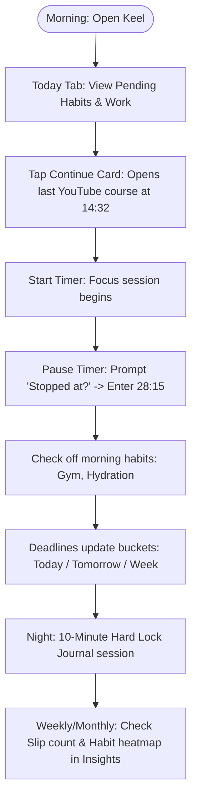

# 01. Problem Analysis & Product Vision: Keel

## 1. Problem Statement

Self-directed learners, students, and independent developers face a persistent friction: juggling goals (finishing a YouTube course, reading technical documentation, mastering a framework, or building a side project) across multiple disconnected productivity tools.

Current workflows typically involve three separate applications:
1. **Notion**: Used for structured project context, documentation bookmarks, notes, and curriculum outlines.
2. **Trello / Kanban Boards**: Used for categorizing tasks into timeline buckets (Today, Tomorrow, This Week, Later).
3. **HabitNow / Streak Trackers**: Used for tracking daily physical and mental routines, maintaining streaks, setting alarms, and tracking habits.

### Key Pain Points

1. **Context Fragmentation & App Hopping**:
   Switching between Notion, Trello, and HabitNow multiple times a day creates cognitive fatigue. Users spend more energy organizing tools than executing work.
2. **Loss of Stopping Points**:
   Notion stores links and notes, but lacks a native, friction-free way to log the exact stopping point (e.g., video timestamp `14:32`, documentation chapter `Sec 3.4`, or course lesson `Module 2 - Lesson 4`). Returning to a project requires remembering or searching for where one left off.
3. **Weak Accountability on Delays (Slip Blindness)**:
   Kanban tools let users drag cards forward endlessly without confronting procrastination. There is no historical metric of how many times a task was postponed or how many days past its deadline it finished.
4. **Student vs. Generic Tool Mismatch**:
   Generic task managers assume binary tasks ("Email John"). Students work on compound items with volume (e.g., a 40-video course with a deadline in 10 days). Generic apps do not calculate dynamic daily targets (e.g., "4 lessons/day needed").
5. **Ineffective Reminders**:
   Standard push notifications are easily dismissed or swiped away. Alarms are jarring and binary. There is no adaptive escalation (nudge → firm alert → persistent alarm) that respects task priority.
6. **Lack of Writing & Reflection Discipline**:
   Journaling apps allow casual open-and-close sessions. Without strict constraints, users skip reflection or get distracted mid-entry.

---

## 2. Comparative Audit of Existing Tools

| Dimension | Notion | Trello | HabitNow | **Keel** |
| :--- | :--- | :--- | :--- | :--- |
| **Primary Strength** | Flexible notes & rich databases | Visual stage categorization | Habit streaks & routine timers | Unified daily command center |
| **Stopping Point Tracking** | Manual text field edit (heavy) | None | None | **Native "Stopped at?" on timer pause; 2-tap resume** |
| **Deadline Organization** | Manual date filter formula | Manual board dragging | Date scheduling only | **Automatic buckets (Today / Tomorrow / Week / Later)** |
| **Slip & Delay Tracking** | Formulas required | None | Missed days counter | **Automatic slip count & days late analytics** |
| **Daily Target Pacing** | Custom formula required | None | None | **Auto-calculated (units remaining / days left)** |
| **Routine Habits** | Clunky relational tables | Unsuitable | Excellent | **Built-in day-wise habits + rest freezes** |
| **Journaling** | Unconstrained page | Unsuitable | Simple note | **10-minute hard lock (distraction-proof)** |
| **Platform / Pricing** | Cloud / Freemium | Cloud / Freemium | Android / Freemium | **100% Free, offline-first Android native (Expo)** |

---

## 3. Product Vision & Philosophy

### Unique Selling Proposition (USP)
> **"Pick up exactly where you stopped, and see honestly where you slipped."**

### Core Principles

1. **Bare-Minimum & Smart**:
   No nested pages, no complex relational databases, no markdown block gymnastics. Every screen does one job with minimum taps.
2. **Honest Metrics**:
   No vanity streaks or hidden delays. When work is pushed back, Keel logs a slip. When a timer runs unattended for over 3 hours, Keel guards against artificial time bloat.
3. **Work and Habits Are Distinct**:
   Habits are day-wise recurring routines (gym, hydration, meditation). Work items are finite projects with timelines, milestones, notes, and stopping points. They share the Today dashboard but retain separate tracking and insights.
4. **Local-First & Zero Cost**:
   No subscription, no account creation, no external cloud database dependency. All data resides safely in local SQLite on the user's Android device, with full JSON export/import for backup.

---

## 4. User Persona & Scenarios

### Persona: The Self-Directed Learner / Developer
- **Profile**: A student or software engineer juggling college coursework, personal coding projects, YouTube tutorials, and fitness routines.
- **Environment**: Android phone as the primary daily companion.
- **Desire**: To open one app in the morning, see what needs to be done, tap once to resume learning, and close the day with an honest, locked reflection session.

### Daily Scenario Walkthrough

---

## 5. Success Criteria & North Star Metric

- **Primary Benchmark (2-Tap Resume)**:
  From app launch to resuming an in-progress course at the exact timestamp or page must take **at most 2 taps**.
- **Accountability Metric**:
  Zero untracked task slips; 100% visibility into planned vs. actual project completion dates.
- **Discipline Metric**:
  10-minute uninterrupted daily journaling completion rate without mid-session abandonment.
