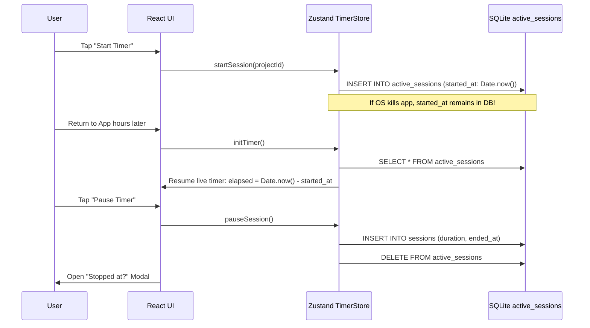

# 05. Technical Requirements Document (TRD): Keel

## 1. Technical Vision & Architectural Decisions

Keel is designed as a **100% offline-first, local-first Android application**. It has zero remote server dependencies, zero recurring subscription costs, and requires no account creation or login.

### 1.1 Architectural Principles
1. **Local-First Reliability**: All project data, sessions, notes, habits, and journals reside in an on-device SQLite database via `expo-sqlite`.
2. **Deterministic State over Ephemeral Loops**: Long-running operations (such as session timers and journal locks) rely on immutable epoch timestamps rather than volatile background tick counters.
3. **Pure Function Rules**: Business calculations (bucket allocations, streak evaluations, daily target divisions, slip counts) are isolated as pure, testable TypeScript functions with no UI or database side-effects.
4. **Zero-Cost Toolchain**: Built strictly using free, open-source libraries and standard Android developer tooling.

---

## 2. Technology Stack & Component Selection

| Layer | Chosen Technology | Rationale & Trade-Offs |
| :--- | :--- | :--- |
| **Mobile Framework** | **React Native + Expo** | Modern developer experience, unified TypeScript codebase, access to native Android APIs without full native boilerplate. |
| **Routing / Navigation** | **Expo Router (v3+)** | File-based routing matching modern Next.js conventions; robust tab layout and modal sheet handling. |
| **Language** | **TypeScript (Strict Mode)** | Complete type safety across business logic, database queries, and component props. |
| **Local Database** | **`expo-sqlite` (next)** | High-performance, zero-config on-device relational SQL engine. |
| **ORM & Migrations** | **Drizzle ORM** | Lightweight, type-safe SQL query builder with zero runtime overhead and automated migration generation. |
| **Client State** | **Zustand** | Minimalist state stores with zero boilerplate for active timers, journal lock state, and transient UI sheets. |
| **Styling & Theme** | **NativeWind (v4)** | Tailwind CSS utility system for React Native, enabling rapid, maintainable design token application. |
| **Animations / Gestures**| `react-native-reanimated` | 60fps native-thread animations for drawer sheets, progress rings, and timer transitions. |
| **Date Calculations** | **`date-fns`** | Tree-shakeable, immutable date math for calendar intervals, streaks, and bucket assignment. |
| **Validation** | **Zod** | Runtime validation for form inputs and full JSON backup/restore payloads. |
| **Visual Charts** | **`react-native-svg`** | Lightweight, dependency-free SVG rendering for GitHub-style habit heatmaps and Gantt calendar bars. |
| **Notifications** | **`expo-notifications`** | Android local notifications for nudges and scheduled reminders. |
| **Alarms & Audio** | Native Android Intent / Audio | Exact alarms via Android `SCHEDULE_EXACT_ALARM` with dedicated sound channel. |
| **Screen Persistence** | **`expo-keep-awake`** | Prevents device screen timeout during active 10-minute journal sessions. |
| **Backup / Export** | `expo-file-system` + `expo-sharing` | Exporting complete SQLite snapshot as structured JSON; importing and restoring data safely. |

---

## 3. System Constraints & Non-Functional Requirements

### 3.1 Performance Benchmarks
- **Cold App Launch**: Time to interactive under $1,500\text{ ms}$ on mid-tier Android devices.
- **Scroll Frame Rate**: Steady 60fps across high-density lists (e.g. 100+ projects and notes).
- **Database Query Latency**: All read queries across indexed SQLite tables must resolve in $< 15\text{ ms}$.

### 3.2 Footprint & System Resources
- **Production APK Size**: Final release APK bundle must remain $< 35\text{ MB}$.
- **RAM Usage**: Baseline memory consumption must remain $< 90\text{ MB}$.
- **Zero Background Battery Drain**: No continuous background polling tasks. Timers use static timestamp differentials.

### 3.3 Security & Privacy
- All user thoughts, notes, and habits remain strictly on the local device filesystem.
- Zero analytics SDKs, zero crash tracking telemetry sent over the network.
- JSON exports are saved to user-selected device storage folders with standard Android SAF (Storage Access Framework).

---

## 4. Key Subsystem Technical Specifications

### 4.1 Persistence Layer (`expo-sqlite` + Drizzle ORM)
- Database filename: `keel.db`.
- SQLite Pragmas enforced on connection:
  ```sql
  PRAGMA journal_mode = WAL;
  PRAGMA foreign_keys = ON;
  PRAGMA synchronous = NORMAL;
  ```
- Drizzle ORM ensures compile-time type validation of all queries, preventing SQL injection and schema mismatch errors.

### 4.2 Active Session Management (Surviving App Termination)


### 4.3 Android Journal Hard Lock Technical Mechanics
1. **Back Button Override**:
   ```typescript
   useEffect(() => {
     const sub = BackHandler.addEventListener('hardwareBackPress', () => {
       ToastAndroid.show('Journal session is locked.', ToastAndroid.SHORT);
       return true; // Prevent exit
     });
     return () => sub.remove();
   }, []);
   ```
2. **Keep Screen On**:
   ```typescript
   useKeepAwake(); // Activated when journal session mounts
   ```
3. **App State Listener (Reset Penalty)**:
   ```typescript
   useEffect(() => {
     const sub = AppState.addEventListener('change', (nextState) => {
       if (nextState !== 'active' && isSessionLocked) {
         // User switched apps or went home
         resetJournalTimerToTenMinutes();
         recordInterruptionPenalty();
       }
     });
     return () => sub.remove();
   }, [isSessionLocked]);
   ```
4. **Screen Pinning (`startLockTask`)**:
   - In bare/development build, invokes native Android `Activity.startLockTask()` to request OS kiosk mode.

---

## 5. Development & Build Workflow

- **Local Development**:
  - Run with local development client: `npx expo run:android`.
  - Android Studio local emulator or physical Android phone connected via ADB.
- **Expo Prebuild**:
  - Prebuild generates clean `/android` native directory with custom Android manifest permissions and intent filters.
- **Production Build**:
  - Local APK build command: `cd android && ./gradlew assembleRelease`.
  - Generates standalone, sideloadable `app-release.apk` with zero cloud build costs.
