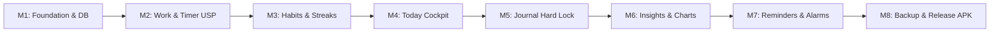

# 10. Development Milestones & Phased Execution Plan: Keel

## 1. Roadmap & Phase Summary

The development of Keel is structured into 8 modular, incremental milestones. Each phase delivers a complete, independently testable layer of the application.

---

## 2. Milestone Breakdown

### Milestone 1: Foundation, Styling & Local Database
- **Deliverables**:
  - Scaffold Expo TypeScript project with Expo Router v3.
  - Configure NativeWind (Tailwind CSS) and dark OLED design tokens (`colors.ts`).
  - Set up `expo-sqlite` and Drizzle ORM client with WAL mode and foreign keys enabled.
  - Implement SQLite migrations for all schema tables (`habits`, `projects`, `sessions`, `notes`, `journal_entries`).
  - Build the 5-tab navigation scaffold (`/today`, `/habits`, `/work`, `/journal`, `/insights`).
- **Done Criteria**: App builds and runs on Android emulator; bottom tab bar switches between placeholder screens with smooth 60fps transitions.

---

### Milestone 2: Work Management, Timer & The 2-Tap Resume USP
- **Deliverables**:
  - Implement Project CRUD operations in `projectRepository.ts`.
  - Build pure rule functions for `calculateBucket()` and `calculateDailyTarget()`.
  - Create the **Work Screen**: Buckets view (`Today & Overdue`, `Tomorrow`, `This Week`, `Later`).
  - Build the **Session Timer Widget**: Epoch-based persistence surviving app closure.
  - Implement the **"Stopped at?" Modal**: Dynamic inputs for video timestamp, course lesson, book page, or task summary.
  - Implement **Project Notes** with inline timestamp chips (`12:40`) and YouTube deep-linking via Android intents.
  - Implement **Forgot-Timer Guard**: 3-hour alert and auto-pause clamping.
- **Done Criteria**: User can create a YouTube course, start the timer, pause, enter timestamp `14:20`, and tap the timestamp to launch YouTube directly at `14:20`.

---

### Milestone 3: Habits, Streaks & Rest-Day Freezes
- **Deliverables**:
  - Implement Habit CRUD operations in `habitRepository.ts`.
  - Pure rule function `computeHabitStreak()` supporting daily, weekday, and custom day frequencies.
  - Build the **Habits Screen**: Daily routine checklist with haptic check-off animations.
  - Implement **Monthly Freeze Logic**: 2 freezes allowance per month, tracking in `habit_freezes` table.
  - Add/Edit Habit bottom sheet with recurrence selector and reminder time picker.
- **Done Criteria**: Checking off a habit increments streak; missing a day and applying a freeze preserves the streak without exceeding the 2/month limit.

---

### Milestone 4: Today Cockpit & Quick Capture
- **Deliverables**:
  - Build the unified **Today Screen**:
    - **Continue Card (Hero)**: Displaying the last active project and resume marker with 1-tap "Resume" action.
    - **Habits Pending Section**: Live list of incomplete routines scheduled for today.
    - **Work Pending Section**: Live list of projects due today or overdue with daily target badges.
  - Implement **Quick Capture**: Header action modal allowing instant 1-line item creation into the `Later` bucket.
- **Done Criteria**: Opening the app shows today's agenda; tapping "Resume" on the Continue Card opens the link and initiates the timer in a single tap.

---

### Milestone 5: Journal Hard Lock
- **Deliverables**:
  - Build the **Journal Screen**:
    - Pre-session initiation card with strict lock warning.
    - Fullscreen distraction-free editor hiding status bar and tab bar.
    - 10-minute (600s) circular countdown timer.
  - Implement the **Tri-Layer Defensive Lock**:
    - Intercept hardware/gesture Back button with `BackHandler`.
    - Prevent display timeout via `expo-keep-awake`.
    - Implement `AppState` listener: Reset timer to 600s upon app backgrounding or app switching.
  - Continuous SQLite draft autosave on every keystroke.
  - Sunday Weekly Review mode (20-minute reflection).
- **Done Criteria**: User starts a 10-minute session; pressing Home and reopening resets the timer back to 10:00, while preserving the entered text draft.

---

### Milestone 6: Insights, Heatmaps & Calendar Bars
- **Deliverables**:
  - Build the **Insights Screen** with segmented control: `[ Habits Insights | Work Insights ]`.
  - **Habits Insights**:
    - Pure SVG 90-day GitHub-style contribution heatmap.
    - Streak leaderboard and consistency percentages.
  - **Work Insights**:
    - Focused hours bar chart (daily and weekly sums).
    - Project distribution breakdown by type.
    - On-time completion % and slip statistics.
  - Build the **Project Calendar View** in the Work tab (Gantt-style timeline bars with type tags).
- **Done Criteria**: Heatmap accurately reflects past 90 days of habit logs; work stats display honest slip counts and total hours logged.

---

### Milestone 7: Android Platform Reminders & Exact Alarms
- **Deliverables**:
  - Configure Android exact alarm permissions (`SCHEDULE_EXACT_ALARM`, `USE_EXACT_ALARM`).
  - Configure notification channels: `keel-nudge` (standard), `keel-alarms` (high-priority, looping audio, full-screen intent).
  - Implement **Escalate Reminder Ladder** (Nudge → Firm vibration → Full Alarm).
  - Implement **Smart Snooze**: Snoozing pushes item to Tomorrow or Later and records an accountability slip.
  - Add boot receiver to reschedule reminders following device reboot.
- **Done Criteria**: Scheduled alarm triggers looping audio even in Android silent mode; dismiss stops audio; snooze increments slip count.

---

### Milestone 8: JSON Backup, APK Build & Polish
- **Deliverables**:
  - Implement database export to `.json` and file share via `expo-sharing`.
  - Implement database import and restoration with Zod schema validation.
  - Run full test suite (`Jest`) covering all pure rules and repositories.
  - Build standalone release APK locally using `cd android && ./gradlew assembleRelease`.
  - Conduct final usability verification against the North Star 2-Tap Resume benchmark.
- **Done Criteria**: Sideloadable `.apk` installs on Android device; all features work offline with zero external network calls.
